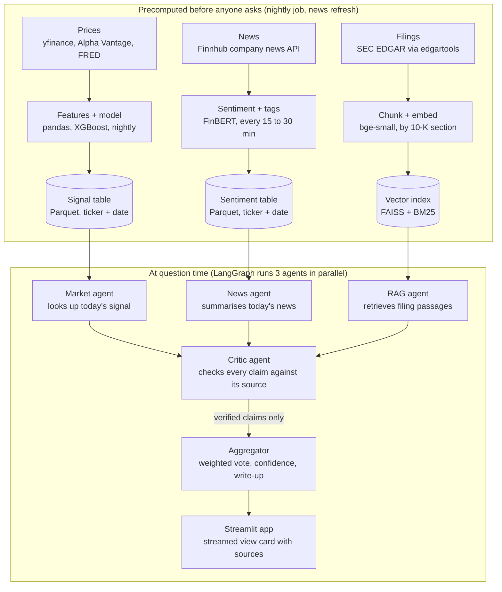
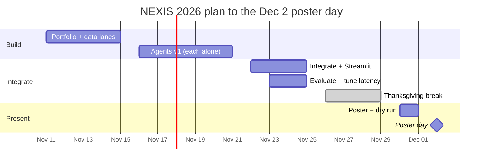

# NEXIS 2026: Project Charter

Last updated: Nov 11, 2026 

## Project at a glance

NEXIS 2026 is a multi-agent AI system that turns stock prices, live news and SEC filings into a cited, cross-checked buy, hold or sell view for a small portfolio, answered in seconds.

| Item | Detail |
| --- | --- |
| Project name | NEXIS 2026 |
| One-line pitch | A fast, verified research assistant that explains why a stock looks like a buy, hold or sell, with sources for every claim |
| Team | 6 students, AI Finance team |
| Timeline | Now to the presentation on Dec 2, 2026 (3 weeks) |
| Final deliverables | Poster and live Streamlit demo at the school poster day (Dec 2), evaluation report, short paper draft for publication |
| Portfolio | 5 to 8 companies in one industry (to be confirmed) |

## Problem statement

Investors who want to decide whether to buy, hold or sell a stock must combine three information streams that live in different places and move at different speeds: daily price movements, breaking news, and long annual reports (10-K filings).

Tools that combine these streams already exist, but none is fast, open and verified at once. Bloomberg's ASKB and AlphaSense fuse filings, news and data with citations, but are closed, paid enterprise products. Research frameworks such as TradingAgents and FinRobot run multi-agent LLMs over prices, news and fundamentals, but judge success mainly by returns or report quality, not by whether each claim is true or how fast the answer comes. The accuracy gap is real: on a FinanceBench sample, a GPT-4 Turbo retrieval system failed 81% of filing questions.

**Problem statement:** There is no open, reproducible system that fuses market data, news sentiment and company filings into one decision view, verifies every claim against its source, and measures both accuracy and speed.

## What problem it solves

NEXIS gives a junior analyst, portfolio manager or informed retail investor one answer that combines all three streams, explains its reasoning, and cites the exact source of each claim.

| Pain today | How NEXIS solves it |
| --- | --- |
| Information is scattered across price charts, news sites and 100-page filings | Three data lanes feed one fused view per ticker per day |
| AI summaries invent numbers and give no sources | A critic agent checks every claim against the retrieved source before it is shown |
| Price models are black boxes | Each signal comes with drivers: which features, which headlines, which filing passage |
| Answers are slow | Heavy work is precomputed nightly; at question time agents run in parallel and the answer streams |
| Nobody knows if the tool is any good | Every component is scored against a naive baseline and a hand-labelled test set |

**Where NEXIS adds something new:** multi-agent finance AI is not new (see Market landscape below). NEXIS contributes the combination existing work leaves out: claim-level verification by a critic agent, scored on a labelled test set, plus a measured end-to-end latency budget, built on free data so anyone can reproduce it.

**Positioning:** NEXIS is decision support, not trading advice. It explains and evidences a view; the human decides.

## Market landscape and related work

At least four products and research projects already do parts of what NEXIS does; NEXIS should position itself as the open, verified and fast version, and cite these directly in the paper's related work.

| Name | Type | What it already does | What it leaves open for NEXIS |
| --- | --- | --- | --- |
| [Bloomberg ASKB](https://www.marketsmedia.com/bloomberg-introduces-agentic-ai-to-the-terminal/) (Feb 2026) | Commercial, Bloomberg Terminal | Network of AI agents working in parallel across Bloomberg data, news and documents | Closed and Terminal-only; results cannot be reproduced or benchmarked by outsiders |
| [AlphaSense Generative Search](https://www.alpha-sense.com/solutions/generative-ai-industry-company-research/) | Commercial research platform | Natural-language answers over filings, transcripts and broker research, cited to exact snippets | Paid enterprise product; citations help users check, but checking is still left to the user |
| [TradingAgents](https://arxiv.org/html/2412.20138v4) (UCLA, Tauric Research, Dec 2024) | Open-source research framework | Fundamental, sentiment, news and technical analyst agents, bull and bear debate, trader and risk team | Scored on returns, Sharpe ratio and drawdown; a [public comment](https://huggingface.co/papers/2412.20138) raises look-ahead concerns in its backtests |
| [FinRobot](https://arxiv.org/html/2405.14767v1) (AI4Finance, 2024) | Open-source agent platform | Multi-agent platform for forecasting, document analysis and equity research reports | Closest overlap with NEXIS; we must cite it and show our critic and latency results add to it |
| [FinanceBench](https://prnewswire.com/news-releases/patronus-ai-launches-industry-first-llm-benchmark-for-finance-to-address-hallucinations-301990858.html) (Patronus AI, 2023) | Benchmark | About 10,000 question and answer pairs over public filings | Shows retrieval systems hallucinate; NEXIS can test its RAG agent on a subset |
| [FinReflectKG HalluBench](https://arxiv.org/abs/2603.20252) (Mar 2026) | Benchmark | Tests hallucination detectors on 10-K questions; LLM judges reach F1 0.82 to 0.86 | A ready baseline to compare our critic agent against |

**What this means for NEXIS:** do not claim to be first to fuse these sources. Claim to be an open, reproducible system that verifies claims, measures speed, and reports results on a public benchmark (a FinanceBench subset) alongside our own test set.

## Objectives, scope and success metrics

The project succeeds if NEXIS beats a naive baseline on direction, cites correctly at least 9 times in 10, and answers in under 8 seconds. Targets below are proposals for the team to confirm.

| Area | Metric | Target |
| --- | --- | --- |
| Market model | Next-day and 5-day direction accuracy | Beats naive baselines (always-up, and yesterday's direction) on walk-forward test |
| News | Sentiment agreement with a hand-labelled sample of 100 headlines | 75% or more |
| RAG | Retrieval recall@5 on a 75-question test set from the 10-Ks | 0.80 or more |
| RAG | Answer correctness on the same test set | 85% or more |
| Critic | Citation faithfulness (claim supported by its cited passage) | 90% or more |
| Critic | Planted false claims caught | 80% or more |
| Latency | Time to first word on screen | 1.5 s or less |
| Latency | Full answer, 95th percentile | 8 s or less |

**In scope:** 5 to 8 companies in one industry; daily (not intraday) prices; English news; 10-K and 10-Q filings; a Streamlit demo app; an evaluation report.

**Out of scope:** placing real trades, intraday or high-frequency signals, portfolio optimisation, more than one industry, user accounts.

## Data sources and date ranges

Four sources feed NEXIS, all free or low cost; prices go back 10 years so the model sees several market regimes, while news and filings cover the recent years the app will be asked about.

| Lane | Source | What we pull | Date range | Why this range |
| --- | --- | --- | --- | --- |
| Prices | yfinance, Alpha Vantage as backup | Daily open, high, low, close, adjusted close, volume | Jan 2015 to today | Covers the 2018 sell-off, the 2020 crash, the 2022 rate hikes and the 2023 to 2025 rally, so the model is tested on more than one regime |
| News | Finnhub company news API | Headline, summary, source, URL, timestamp per ticker | About the last 12 months (free tier limit, to verify) | Enough for live use and a few hundred labelled headlines; longer history is not needed for the demo |
| Filings | SEC EDGAR via edgartools | 10-K sections (Item 1 Business, 1A Risk Factors, 7 MD&A, 8 Financials) and 10-Q updates | FY2020 to FY2025 | 5 to 6 annual reports per company show trends without bloating the vector store |
| Macro (optional) | FRED | Fed funds rate, 10-year yield, VIX, CPI | Jan 2015 to today | Gives the market model context on rates and fear, aligned to the price range |

All lanes join on **ticker + date**. A news item or filing can only be used for a prediction dated after it was published, which prevents look-ahead leakage.

Open question: which 5 to 8 companies and which industry. Data exploration on AAPL as a placeholder is already done.

## Approach: tools and techniques

Five agents each do one job and hand a fixed JSON format to the next; an orchestrator runs the three signal agents in parallel, then the critic, then the aggregator.

| Component | Job | Techniques | Tools |
| --- | --- | --- | --- |
| Market agent | Predict next-day and 5-day direction for a ticker | Features: lagged returns, moving averages, RSI, volatility, volume change, macro; models: logistic regression (baseline), XGBoost or LightGBM; walk-forward validation | pandas, scikit-learn, XGBoost, SHAP for drivers |
| News agent | Score how news is moving each stock today | FinBERT sentiment per headline, daily weighted average per ticker, LLM event tagging (earnings, lawsuit, product, guidance) | Finnhub, Hugging Face transformers, a small fast LLM |
| RAG agent | Answer questions from 10-K and 10-Q filings with citations | Chunk by filing section (about 500 tokens, 50 overlap), hybrid search (BM25 + vectors), optional reranker, metadata filter on ticker and year | edgartools, sentence-transformers (bge-small), FAISS or Chroma, rank-bm25 |
| Critic agent | Verify each claim before it is shown | Split answer into claims, check each against its cited passage, re-compute numbers, flag conflicts between agents | LLM-as-judge with a strict output schema |
| Aggregator | Produce the final view | Weighted vote of the three signals, confidence score, keep only verified claims | Python rules first, learned weights if time allows |
| Orchestration | Run agents and pass state | Parallel branches, timeouts, caching | LangGraph, asyncio, Redis or disk cache |
| App | Show the result | Streaming answer, signal cards, source links | Streamlit |
| Evaluation | Prove it works | Naive baselines, 75-question labelled test set, RAGAS-style metrics, latency logging | pytest, RAGAS, a timing logger |

Code lives in one GitHub repo with a folder per lane and agent; each agent can be run and tested on its own before integration.

## Architecture and data lineage

Data flows top to bottom: each lane goes source, processing, store before any question arrives; at question time the three agents read from the stores in parallel, and only claims the critic verifies reach the app.



Lineage rule: every stored row keeps its ticker, date and source URL or filing section, so any number on the final card can be traced back to where it came from.

## Latency design

The answer stays fast because almost all heavy work happens before anyone asks: at question time NEXIS only looks things up, runs short LLM calls in parallel, and streams the answer.

**Rule 1: precompute.** A nightly job (and a news refresh every 15 to 30 minutes) computes features, model predictions, sentiment scores and filing embeddings, and stores them per ticker per day. The market agent then answers with a lookup, not a model run.

**Rule 2: run in parallel.** Market, news and RAG agents start at the same moment. Total wait is the slowest agent, not the sum of all three.

**Rule 3: use small models where you can.** A small, fast LLM handles news tagging and the critic; only the final write-up uses a larger model.

**Rule 4: stream.** The first sentence appears while the rest is still being written, so the user waits about 1.5 s, not 8 s.

**Rule 5: cache.** Identical questions for the same ticker and day return the stored answer instantly.

| Stage at question time | Budget |
| --- | --- |
| Look up precomputed price signal and sentiment | under 0.1 s |
| Retrieve filing passages (hybrid search) | under 0.3 s |
| Three agents in parallel (LLM calls) | 2 to 3 s |
| Critic check | 1.5 to 2 s |
| Aggregator write-up, streamed | first words by 1.5 s, done by 8 s |

Every stage logs its own time, so the team can see which step is slow and fix that one. Latency results become a section of the paper.

## Compute plan

The team PC handles all non-LLM work. Every LLM call (news event tagging, critic, write-up) goes to a hosted API, so the PC's 8 GB of video memory is not a limit.

| Hardware | Spec | What it runs for NEXIS |
| --- | --- | --- |
| GPU | NVIDIA RTX 5060, 8 GB video memory | FinBERT sentiment and bge-small embeddings |
| CPU | Intel Core Ultra 5 225F, 10 cores | XGBoost, pandas features, FAISS and BM25 search, Streamlit |
| RAM | 16 GB DDR5, 1 of 4 slots used | All data for 5 to 8 tickers fits; enough with LLMs on the API |
| NPU | Intel AI Boost | Not used; the tooling is not worth the setup time in 3 weeks |

**Split of work.** Nightly jobs and batch scoring (FinBERT, embeddings, model training) run on the PC's GPU. All LLM work uses the API: a small, fast model for news tagging and the critic, and a larger one for the final write-up. Teammates develop on their own laptops using small sample files and run full jobs on the PC.

**Paper bonus.** Run the critic with a small and a large API model, and compare accuracy, latency and cost per answer. That is a cheap, publishable result.

**Setup notes.**

- RTX 50-series cards need a PyTorch build for CUDA 12.8 or newer. Check with `torch.cuda.is_available()` before anything else.
- Keep API keys in `.env`. Cache every LLM response by ticker, date and prompt, and log tokens per call, so the team can track spend and stay under rate limits.
- Adding a second 16 GB RAM stick (matching speed) doubles memory and enables dual channel. Nice to have, not required now that LLMs run on the API.
- For poster day, run the demo on a laptop using precomputed data plus the API, so it does not depend on remote access to the PC.

## Output: what the user sees

The user picks a ticker or types a question, and gets one view card: the overall signal, the three supporting signals, verified reasons with sources, and anything the critic removed. Figures below are illustrative only.

```markdown
### MSFT · Hold (confidence 0.62) · as of 2026-11-11 16:00 ET

| Signal | Reading | Weight |
|---|---|---|
| Market model | 5-day direction: up, p = 0.57 | 0.40 |
| News sentiment | Mildly positive (+0.21), 14 articles today | 0.30 |
| Filings | Cloud growth strong; capex risk rising | 0.30 |

**Why (verified claims)**
1. Cloud revenue grew year over year in FY2025. [10-K FY2025, Item 7]
2. Management flags rising AI infrastructure spending as a margin risk. [10-K FY2025, Item 1A]
3. Today's headlines focus on a new enterprise AI contract. [Reuters, 2026-11-11]

**Removed by critic:** 1 claim (number not found in cited passage)

Answered in 4.8 s · Decision support, not financial advice
```

Behind the card, every agent returns the same JSON shape, which is the contract the team builds against:

```json
{
  "ticker": "MSFT",
  "as_of": "2026-11-11",
  "agent": "news",
  "signal": "positive",
  "score": 0.21,
  "confidence": 0.7,
  "claims": [
    {"text": "Headlines focus on a new enterprise AI contract",
     "source": "https://...", "verified": null}
  ],
  "latency_ms": 1840
}
```

The critic fills `verified` with true or false; the aggregator drops false claims and writes the card.

## Timeline, risks and assumptions

With 3 weeks to the Dec 2 presentation, everyone builds their piece in parallel until Nov 21, the team integrates and evaluates before Thanksgiving, and Nov 30 to Dec 1 is for the poster and a dry run of the live demo.



Gate before integration: each agent returns the shared JSON format on 3 test tickers by Nov 21.

| Risk | Likelihood | Fallback |
| --- | --- | --- |
| Portfolio not chosen this week | High | Lead picks 6 tickers from one sector by Nov 14; team can swap later |
| Market model does not beat the baseline | Medium | Report it honestly; frame the paper around verification and latency, which do not depend on beating the market |
| Free API limits (Finnhub, Alpha Vantage) | Medium | Cache everything locally; yfinance as backup for prices |
| LLM costs or slow calls | Medium | Small models for news and critic; cache answers; cap tokens |
| Integration breaks late | High | Fix the JSON contract now; one person owns integration from Nov 22 |
| Uneven workload across 6 people | Medium | Weekly progress doc; each task has one owner and a written done-definition |

**Assumptions:** daily data is enough; English news only; the team has modest compute and budget; the presentation is on Dec 2 and the paper draft continues after it. If time runs short, cut to 3 tickers and a rule-based aggregator first.
